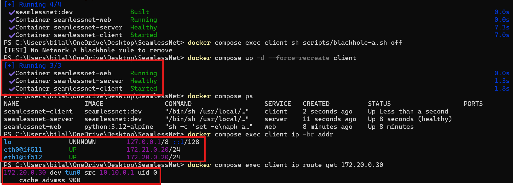
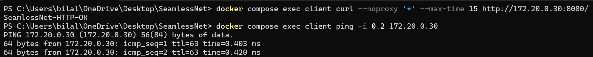
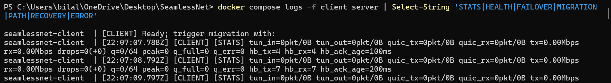
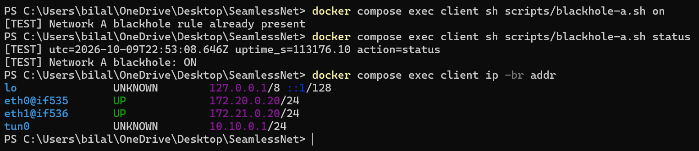
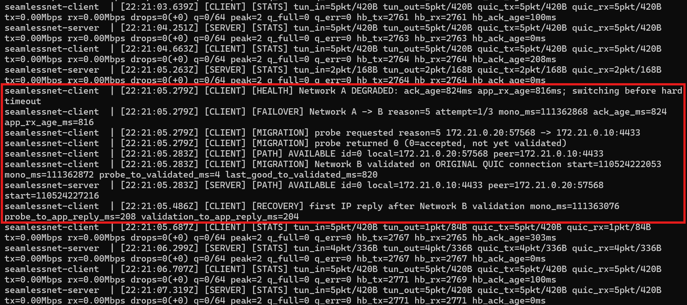
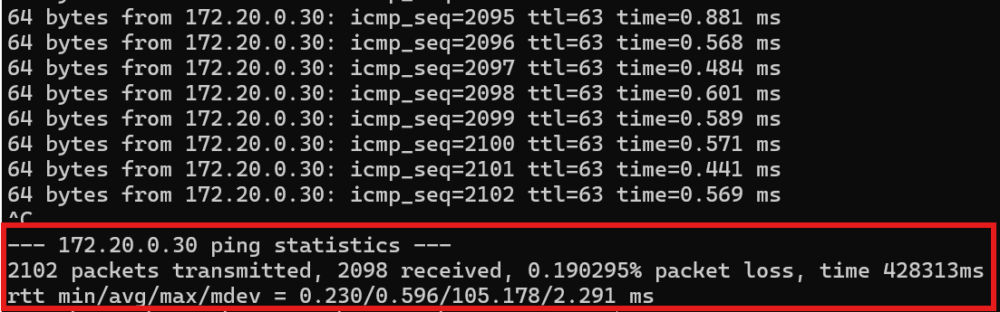
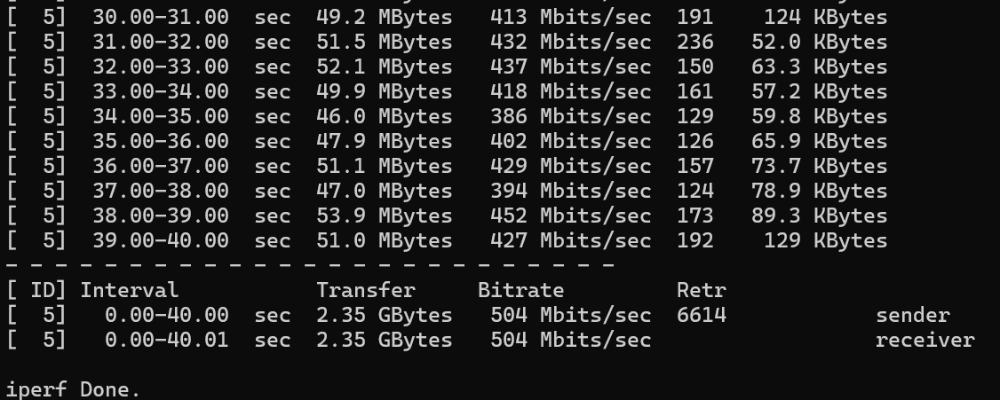
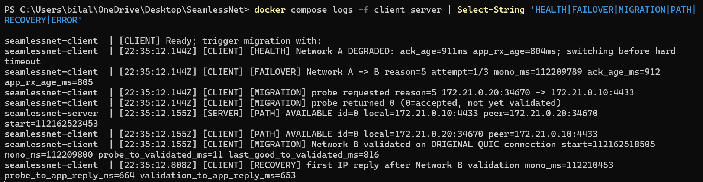

# SeamlessNet — Stage 1 demo

This walkthrough documents the **actual Windows PowerShell / Docker demo**. SeamlessNet automatically detects a silent failure on Network A, validates Network B, and continues application traffic over the **same QUIC connection**.

The screenshots below come from two separate experiments: **a long-running ICMP test** and **a 40-second TCP transfer**. Their results should not be mixed as if they were one run.

## Test environment

| Component | Address / role |
| --- | --- |
| Client TUN | `10.10.0.1/24`, MTU 1000 |
| Server TUN | `10.10.0.2/24`, MTU 1000 |
| Network A | Client `172.20.0.20` -> server `172.20.0.10` |
| Network B | Client `172.21.0.20` -> server `172.21.0.10` |
| Test service | `172.20.0.30`, HTTP `8080`, iperf3 `5201` |

**Three PowerShell terminals run simultaneously:** Terminal 1 generates application traffic, Terminal 2 follows logs, and Terminal 3 injects the fault and checks status. The client, server, and test-service containers also run concurrently. **This does not mean both QUIC paths transmit application data simultaneously**: the prototype switches its active path from A to B.

## 1. Start the containers and check routing

In Terminal 3, from the repository root:

```powershell
docker compose up --build -d
docker compose exec client sh scripts/blackhole-a.sh off
docker compose up -d --force-recreate client
docker compose ps
docker compose exec client ip -br addr
docker compose exec client ip route get 172.20.0.30
```



**Screenshot 01 — Startup.** The client, server, and web containers are running. The client has Network A (`172.20.0.20`) and Network B (`172.21.0.20`), and traffic for `172.20.0.30` is routed via `tun0` with source `10.10.0.1`. Linux interface names can change between runs, so identify networks by IP address.

## 2. Confirm application traffic works

In Terminal 1:

```powershell
docker compose exec client curl --noproxy '*' --max-time 15 http://172.20.0.30:8080/
docker compose exec client ping -i 0.2 172.20.0.30
```



**Screenshot 02 — Before failure.** The HTTP server returns `SeamlessNet-HTTP-OK`, and ICMP replies arrive over the tunnel. The ping command intentionally has **no `-c` limit**: it runs continuously at one request every 200 ms until stopped with **Ctrl+C**. Keep it running while performing Steps 3–5.

## 3. Monitor live events and statistics

In Terminal 2, while Terminal 1 continues pinging:

```powershell
docker compose logs -f client server | Select-String 'STATS|HEALTH|FAILOVER|MIGRATION|PATH|RECOVERY|ERROR'
```



**Screenshot 03 — Monitoring.** `-f` means **follow**: new log lines appear live until you stop the command with Ctrl+C. SeamlessNet reports packet counts, bytes, queue occupancy, drops, and heartbeat activity every second. Per-packet debug logs are off.

**Why does throughput show `0.00Mbps`?** Ping sends only about five 84-byte IP packets per second in each direction: approximately **0.00336 Mbit/s**, which rounds to `0.00` when printed with two decimal places. The nonzero `5pkt/420B` counters show that traffic is actually flowing. For a nonzero Mbps display, run a separate iperf3 test.

## 4. Simulate silent failure on Network A

While ping and live logs are **still running**, use Terminal 3:

```powershell
docker compose exec client sh scripts/blackhole-a.sh on
docker compose exec client sh scripts/blackhole-a.sh status
docker compose exec client ip -br addr
```



**Screenshot 04 — Silent failure.** The updated screenshot confirms that `Network A blackhole: ON` while **both external interfaces remain UP**: `eth0` has Network A (`172.20.0.20/24`) and `eth1` has Network B (`172.21.0.20/24`). The virtual tunnel `tun0` remains present at `10.10.0.1/24`. This demonstrates a **silent failure**: Network A's outgoing QUIC traffic is blocked even though Linux still reports the interface as operational.

The line `[TEST] Network A blackhole rule already present` is **not an error**. It means the `on` command was run again while the blocking rule was already installed; `status` independently confirms the rule is ON.

**Evidence timing:** This replacement screenshot is from a later status-verification run (`22:53:08Z`). The ICMP migration screenshot in Step 5 is from the earlier `22:21` run, whose fault-injection command was recorded at `22:21:04.501Z`. They illustrate the same test mechanism, but are **not screenshots of the same run**. Do not use the later screenshot's timestamp to calculate the earlier run's recovery time. **Do not use the manual migration trigger**: failover should happen automatically.

## 5. Observe automatic migration and recovery

Terminal 2 already follows events using `-f`. You can also retrieve the relevant events afterward in Terminal 3:

```powershell
docker compose logs --since=2m client server | Select-String 'HEALTH|FAILOVER|MIGRATION|PATH|RECOVERY|ERROR'
```



**Screenshot 05 — Migration events (ICMP run).** The logs show the following events:

| Event | Timestamp / measured delay |
| --- | --- |
| Network A degraded; migration requested | `22:21:05.279Z` |
| Heartbeat ACK age at detection | **824 ms** |
| Network B path available | `22:21:05.283Z` |
| Probe -> path validation | **4 ms** |
| First application IP reply after validation | `22:21:05.486Z` |
| Probe -> first IP reply | **208 ms** |
| Validation -> first IP reply | **204 ms** |

The client and server both report Network B addresses (`172.21.0.20` and `172.21.0.10`). The client reports that the **original QUIC connection** was preserved. For the **22:21 ICMP run**, the approximately **985 ms** between its logged blackhole action and the first logged IP reply is an injection-to-observed-recovery interval, **not** a precise measurement of when the link physically failed.

## 6. Let ping continue, then record the result

Keep the **same ping process** running after migration. In this recorded run, it continued for more than seven minutes in total before being stopped manually with Ctrl+C.



**Screenshot 06 — ICMP result.** The final terminal summary shows:

| Metric | Result |
| --- | ---: |
| Transmitted | **2,102** |
| Received | **2,098** |
| Lost | **4** |
| Loss over entire test | **0.190295%** |
| Duration | **428,313 ms** (~7 min 8 s) |
| RTT min / average / max / mdev | **0.230 / 0.596 / 105.178 / 2.291 ms** |

**Interpretation:** The application continued to receive ICMP replies after Network A was blocked and QUIC migrated to Network B. Only four pings were lost over the *entire* run. The summary alone does not prove all four were lost during the handover. The RTT maximum indicates at least one latency spike; it should not be interpreted as the handover duration.

## 7. Run a separate 40-second TCP continuity test

Restore Network A and create a fresh client connection before the TCP test:

```powershell
docker compose exec client sh scripts/blackhole-a.sh off
docker compose up -d --force-recreate client
```

In Terminal 1, start a 40-second transfer:

```powershell
docker compose exec client iperf3 -c 172.20.0.30 -p 5201 -t 40 -i 1 -M 900
```

While it runs, follow the logs in Terminal 2 (the same `docker compose logs -f ...` command). In Terminal 3, about ten seconds into the transfer, run:

```powershell
docker compose exec client sh scripts/blackhole-a.sh on
```

**Do not stop iperf3.** Let it complete normally.



**Screenshot 07 — TCP results.** This separate run finished normally with:

| Metric | Result |
| --- | ---: |
| Duration | **40.00–40.01 s** |
| Sender / receiver data | **2.35 GBytes / 2.35 GBytes** |
| Sender / receiver average bitrate | **504 / 504 Mbit/s** |
| TCP retransmissions | **6,614** |

**Interpretation:** The same TCP transfer completed across the failover without restarting iperf3. The high retransmission count suggests there is room for queue, transport, or processing optimization. These results were measured in a local Docker environment, not a real access network.

## 8. Verify migration during the TCP transfer

The event log from the **TCP run** is separate from the ICMP run:

```powershell
docker compose logs -f client server | Select-String 'HEALTH|FAILOVER|MIGRATION|PATH|RECOVERY|ERROR'
```



**Screenshot 08 — TCP migration.** The logs show Network A degradation at `22:35:12.144Z`, a probe to Network B, path availability at `22:35:12.155Z`, and the first application IP reply at `22:35:12.808Z`.

| TCP-run measurement | Result |
| --- | ---: |
| Probe -> path validation | **11 ms** |
| Validation -> first IP reply | **653 ms** |
| Probe -> first IP reply | **664 ms** |

The QUIC connection start value remains unchanged within the client's migration logs. Taken together with the completed iperf3 result, this supports preservation of the application session during automatic path migration.

## 9. Clean up

```powershell
docker compose exec client sh scripts/blackhole-a.sh off
docker compose up -d --force-recreate client
```

Or stop the environment entirely:

```powershell
docker compose down
```

## Notes and limitations

- **Five-minute idle timeout:** The configured QUIC idle timeout is **300,000 ms**. It applies when the connection has no qualifying QUIC activity; heartbeat exchanges can keep the connection alive even without ping, HTTP, or iperf3 traffic. The seven-minute ping run does not contradict this setting.
- **Simultaneous operations:** The three terminals, containers, monitoring, and fault injection run concurrently. **Network A and Network B are both available**, but application packets use a **single active QUIC path** at a time. This is migration, not simultaneous multipath transport.
- **Scope:** This is a controlled A -> B Docker demonstration with one client and development-only TLS settings. Automatic B -> A switching, real Wi-Fi/cellular/satellite handover, multipath scheduling, and production-grade certificate validation are not implemented.
- **Measurements:** These screenshots show individual runs. Probe-to-validation times are not total network-outage times, and the ICMP loss percentage covers the full 7-minute test.

**Conclusion:** SeamlessNet's Stage 1 prototype demonstrates automatic silent-failure detection, migration of an existing QUIC tunnel to Network B, and continued ICMP and TCP application traffic without recreating the QUIC connection.
